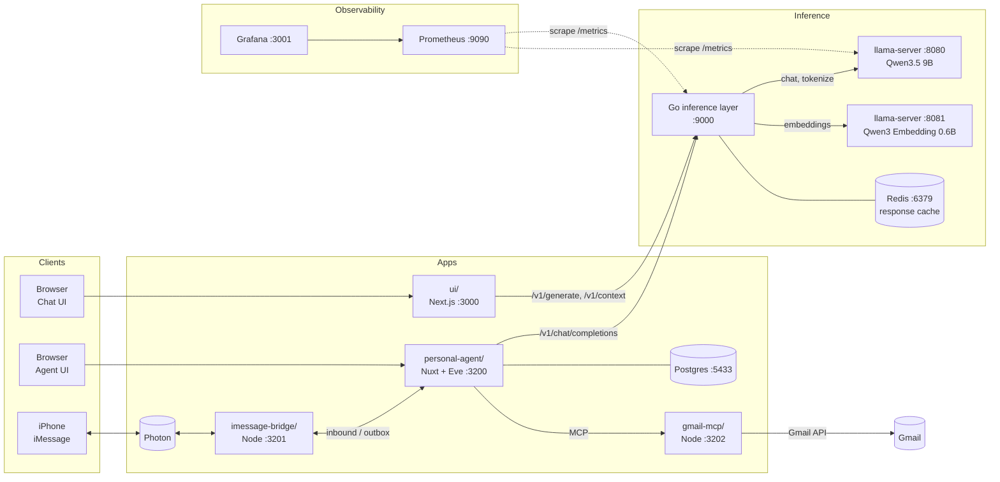

# Ojas's AI Lab

A personal AI stack that runs entirely on one Mac: a local LLM served by
llama.cpp, a Go inference layer with a semantic response cache, admission
control and Prometheus metrics, a chat UI, and a durable personal agent you
can reach from the web or by iMessage.



## Components

| Path | What it is | Port |
|------|------------|------|
| [`*.go`](main.go) | Inference layer: HTTP API in front of llama.cpp | 9000 |
| [`ui/`](ui) | Next.js chat UI for the inference layer | 3000 |
| [`personal-agent/`](personal-agent) | Personal agent (Eve) with a Nuxt web app | 3200 |
| [`imessage-bridge/`](imessage-bridge) | Relays iMessages between Photon and the agent | 3201 |
| [`gmail-mcp/`](gmail-mcp) | MCP server giving the agent access to Gmail | 3202 |
| llama-server (chat) | Qwen3.5 9B, 128K context | 8080 |
| llama-server (embeddings) | Qwen3 Embedding 0.6B, used by the cache | 8081 |
| Postgres | Agent accounts, threads and memory | 5433 |
| Redis | Response cache that survives restarts (optional) | 6379 |
| Prometheus, Grafana | Metrics and the inference dashboard | 9090, 3001 |

### Inference layer (Go, repo root)

A small, dependency-light HTTP server ([`main.go`](main.go),
[`server.go`](server.go)) that owns every call to the model.

| Endpoint | Purpose |
|----------|---------|
| `POST /v1/generate` | Chat generation, JSON or server-sent events. Accepts a prompt or a whole conversation with text attachments. |
| `POST /v1/context` | How many tokens a conversation uses, and the context size. Powers the UI's context meter. |
| `POST /v1/chat/completions`, `GET /v1/models` | OpenAI-compatible pass-through for SDK clients such as the agent, with streaming and tool calling intact. |
| `GET /healthz`, `GET /v1/info` | Worker health and the model being served. |
| `GET /metrics` | Prometheus metrics. |

**Semantic cache** ([`cache.go`](cache.go),
[`redis_cache.go`](redis_cache.go)). `/v1/generate` answers repeated
questions without touching the model. A lookup first tries an exact match on
the prompt's SHA-256, then embeds the prompt with the embedding worker and
accepts the closest cached prompt above a cosine similarity of 0.95. Only a
single question without attachments is cached, since answers inside a longer
conversation depend on what came before, and only answers that finished
rather than hitting `max_tokens`. Entries are kept per chat model, so
switching models never serves another model's answers.

The cache has two backends:

- **In memory** (default): an LRU of `CACHE_SIZE` entries. A semantic lookup
  compares against every cached prompt, and a restart clears it.
- **Redis** (set `REDIS_URL`): entries survive restarts and can be shared by
  several layers. Each entry is a hash of prompt, response and embedding,
  expiring after `CACHE_TTL`. A semantic lookup is one KNN query against a
  Redis Query Engine HNSW vector index, so its cost doesn't grow linearly with
  the cache. Needs Redis 8 (or Redis Stack); [`compose.yaml`](compose.yaml)
  runs one with append-only persistence and LRU eviction past 1 GB.

The OpenAI-compatible routes ([`openai.go`](openai.go)) deliberately skip the
cache: agent turns depend on tool results and must never be replayed.

**Admission control** ([`admission.go`](admission.go)). A single GPU can only
run so many generations at once, and llama-server queues the rest without
limit. The layer puts a bounded queue in front of it instead:

- At most `MAX_CONCURRENT` generations run at once, matching llama-server's
  slots (`-np`, 4 by default).
- At most `MAX_QUEUE` more wait, in arrival order, each for at most
  `QUEUE_TIMEOUT`.
- Beyond that, a request gets `429 Too Many Requests` at once, or `503` if
  its wait times out, both with `Retry-After`. The OpenAI routes use OpenAI's
  error shape, so SDK clients such as the agent back off and retry on their
  own.
- Cache hits never queue, so they stay fast under load, and a client that
  disconnects leaves the queue immediately.

**Configuration** is by environment variable:

| Variable | Default | |
|----------|---------|-|
| `ADDR` | `:9000` | Listen address |
| `LLAMA_URL` | `http://127.0.0.1:8080` | Chat worker |
| `EMBED_URL` | `http://127.0.0.1:8081` | Embedding worker |
| `CACHE_THRESHOLD` | `0.95` | Minimum cosine similarity for a semantic hit |
| `CACHE_SIZE` | `1000` | In-memory cache entries |
| `REDIS_URL` | unset | Use Redis for the cache, e.g. `redis://127.0.0.1:6379` |
| `CACHE_TTL` | `168h` | How long a Redis cache entry lives |
| `MAX_CONCURRENT` | `4` | Generations running at once |
| `MAX_QUEUE` | `16` | Requests allowed to wait for a slot |
| `QUEUE_TIMEOUT` | `60s` | Longest wait for a slot |

### Chat UI ([`ui/`](ui))

A Next.js app with a pastel theme for talking to the model directly. Its API
routes proxy to the inference layer, so the browser never calls it directly.
It streams replies, renders Markdown, takes text attachments, and shows how
much of the context window the conversation uses. Chats are kept in the
browser.

### Personal agent ([`personal-agent/`](personal-agent))

Built on the [Eve](https://eve.dev) agent framework with a Nuxt UI, starting
from [vercel-labs/personal-agent-template](https://github.com/vercel-labs/personal-agent-template).
Its own [README](personal-agent/README.md) and
[docs](personal-agent/docs/ARCHITECTURE.md) cover the internals. Changes made
here:

- **Local model.** [`agent/agent.ts`](personal-agent/agent/agent.ts) talks to
  the inference layer's OpenAI-compatible API. `INFERENCE_CONTEXT_TOKENS`
  tells Eve the window size so it knows when to compact a conversation.
- **Memory in Postgres.** Eve's `fileMemory()` keeps one document per user in
  the `memory_documents` table, through the app's internal API. Memories are
  recalled at the start of every turn and shared across web and iMessage.
- **iMessage channel.** [`agent/channels/imessage.ts`](personal-agent/agent/channels/imessage.ts)
  accepts messages from the bridge and sends typing, replies and turn ends
  back to it. Phone numbers are linked to web accounts in Settings.
- **UI.** A granola theme over a night camp photo, a glass chat panel, and a
  context window meter in the composer, fed by the token usage Eve streams
  after each model call.

### iMessage bridge ([`imessage-bridge/`](imessage-bridge))

Photon delivers inbound iMessages to a connected SDK client rather than to a
webhook, so [`bridge.ts`](imessage-bridge/bridge.ts) holds that connection
open. It forwards each inbound text to the agent's `/imessage/inbound` route
and serves a local `/outbox` that the agent posts replies to. Both directions
are authenticated with `INTERNAL_API_SECRET`, and nothing listens on a public
address, so no tunnel is needed.

### Gmail MCP server ([`gmail-mcp/`](gmail-mcp))

[`server.ts`](gmail-mcp/server.ts) serves MCP over Streamable HTTP on
`127.0.0.1:3202`, and the agent reaches it through
[`agent/connections/gmail.ts`](personal-agent/agent/connections/gmail.ts).
It calls the Gmail API as the account that `npm run auth` signed in with,
keeping only the refresh token in `gmail-mcp/.data/`. Requests carry
`INTERNAL_API_SECRET`, and only signed-in callers get the connection, so an
iMessage sender without a linked profile cannot read the mailbox.

| Tool | |
|------|-|
| `search_threads`, `get_thread`, `list_labels` | Read, with bodies cut short for the local model |
| `modify_thread_labels`, `create_label` | Archive, star, mark read, label |
| `create_draft` | Save a new message or a reply in a thread |
| `send_message`, `send_draft` | Send; each send waits for approval in the web chat |

## Request flows

**Chat UI.** Browser → `ui` API route → `POST /v1/generate` → cache hit, or
llama-server → tokens streamed back as server-sent events.

**Agent, web.** Browser → Nuxt → Eve session → memory recall from Postgres →
`POST /v1/chat/completions` through the inference layer → llama-server → tool
calls run by Eve → reply streamed to the browser.

**Agent, iMessage.** iPhone → Photon → bridge → `POST /imessage/inbound` →
same agent turn as the web, under the linked account → replies posted to the
bridge outbox → Photon → iPhone.

## Running it

Requirements: macOS on Apple silicon (24 GB is comfortable), Go, Node 24,
pnpm (through corepack), Docker, and llama.cpp (`brew install llama.cpp`).

1. **Download the models** into the repo root:

   ```bash
   curl -LO https://huggingface.co/unsloth/Qwen3.5-9B-GGUF/resolve/main/Qwen3.5-9B-Q4_K_M.gguf
   curl -LO https://huggingface.co/Qwen/Qwen3-Embedding-0.6B-GGUF/resolve/main/Qwen3-Embedding-0.6B-Q8_0.gguf
   ```

2. **Start Redis, Prometheus and Grafana** (optional, needs Docker):

   ```bash
   docker compose up -d
   ```

3. **Start the model workers and the inference layer** (one terminal each):

   ```bash
   llama-server -m Qwen3.5-9B-Q4_K_M.gguf -ngl 99 --jinja --port 8080 \
     -c 131072 -fa on -ctk q8_0 -ctv q8_0 -ub 2048 --metrics \
     --temp 1.0 --top-p 0.95 --top-k 20 --min-p 0 --presence-penalty 1.5
   llama-server -m Qwen3-Embedding-0.6B-Q8_0.gguf --embeddings \
     --pooling last -ngl 99 -c 8192 -b 8192 -ub 8192 --port 8081
   REDIS_URL=redis://127.0.0.1:6379 go run .
   ```

   Leave out `REDIS_URL` to keep the cache in memory.

   [`examples.txt`](examples.txt) has sample requests for every endpoint.

4. **Chat UI**: `cd ui && npm install && npm run dev`, then open
   http://localhost:3000.

5. **Personal agent**:

   ```bash
   cd personal-agent
   cp .env.example .env   # then fill in the secrets
   docker compose -f compose.local.yaml up -d
   corepack pnpm install
   PORT=3200 corepack pnpm dev
   ```

   Open http://localhost:3200. See
   [`docs/ENVIRONMENT.md`](personal-agent/docs/ENVIRONMENT.md) for every
   variable.

6. **iMessage (optional)**: set `IMESSAGE_PROJECT_ID` and
   `IMESSAGE_PROJECT_SECRET` in `personal-agent/.env`, then
   `cd imessage-bridge && npm install && npm start`. Link your phone number
   in the agent's Settings.

7. **Gmail (optional)**: in the Google Cloud console, enable the Gmail API,
   add yourself as a test user on the OAuth consent screen, and create an
   OAuth client of type **Desktop app**. Put its id and secret in
   `personal-agent/.env` as `GOOGLE_CLIENT_ID` and `GOOGLE_CLIENT_SECRET`,
   then:

   ```bash
   cd gmail-mcp && npm install
   npm run auth   # one-time Google sign-in
   npm start
   ```

## Observability

`docker compose up -d` starts Prometheus, which scrapes the inference layer
and llama-server every 5 seconds, and Grafana at http://localhost:3001 with
the **Inference layer** dashboard
([`observability/`](observability)) already loaded:

- **Cache hit rate**, lookups by result (exact, semantic, miss) and lookup
  latency.
- **Time to first token**, p50 and p95, for cached answers and the model.
- **Tokens per second**: decode speed per generation and overall
  throughput, from llama-server, so agent traffic counts too.
- **Queue depth**, requests in flight, queue wait and rejections.
- Request rate and p95 latency by route and status.

The layer's own series are prefixed `inference_`; llama-server's are
`llamacpp:` and need its `--metrics` flag.

## Benchmark

[`cmd/bench`](cmd/bench) replays a prompt set
([`prompts.txt`](cmd/bench/prompts.txt)) against `/v1/generate`: each
question as written, an exact repeat, then paraphrases, interleaved with
other questions. Some questions are near misses of each other (the capital
of Austria and of Australia, HTTP 429 and 503), so the benchmark also counts
**wrong hits**, where the cache returned another question's answer. Run it
on an empty cache:

```bash
docker compose exec redis redis-cli FLUSHALL
go run ./cmd/bench
```

It prints the hit rate (exact and semantic), wrong hits, and p50, p95 and
mean latency to the first token and to the full answer, for cached answers
and for generated ones, plus the speedup between them. `-concurrency N`
replays with N requests in flight, which also exercises admission control.

## Choosing the context window

`-c` on the chat worker and `INFERENCE_CONTEXT_TOKENS` in the agent's `.env`
must match. The agent's instructions and tool definitions alone take about
24K tokens. Qwen3.5 9B supports 256K natively, and only 8 of its 32 layers keep
a KV cache, so 128K with an 8-bit cache costs about 2 GB. Larger windows fit
in memory, but the agent only compacts history near the limit, so very long
chats get slow first.

## Upstream template

`personal-agent/` was merged with its history as a git subtree. To pull later
template changes:

```bash
git subtree pull --prefix=personal-agent \
  https://github.com/vercel-labs/personal-agent-template main
```
